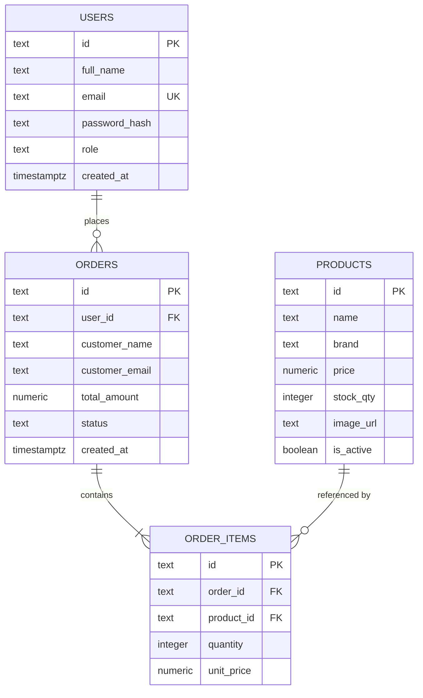

# ICT2142 E-Business Systems
## Week 08 Practical: Database Integration & Admin Dashboard (Phase 3)
### Student Project Diary & Technical Documentation Report

---

### Project Overview
- **Course Module:** ICT2142 - E-Business Systems
- **Lab Practical:** Week 08 - Database Integration & Admin Dashboard
- **Project Name:** Krono Watches E-Commerce Store
- **Currency:** Sri Lankan Rupee (LKR)
- **Tech Stack:** Next.js (App Router), TypeScript, React, Supabase (PostgreSQL), TailwindCSS
- **GitHub Repository:** [Krono Watches](https://github.com/mohamedrazim11-maker/Krono_Watches.git)

---

## Completed Tasks Checklist (Week 08)

- [x] **Milestone 1 — Database Schema:** Created tables for `USERS`, `PRODUCTS`, `ORDERS`, and `ORDER_ITEMS` with primary keys and foreign keys.
- [x] **Milestone 2 — Dynamic Product Catalog:** Connected products to the database so items load live from the database instead of hard-coded lists.
- [x] **Milestone 3 — Order Persistence & Checkout:** Saved orders and order items to the database during checkout, recalculated order totals on the server, and updated product stock automatically.
- [x] **Milestone 4 — Protected Admin Area:** Protected `/admin` routes using middleware so only users with the `admin` role can access the dashboard.
- [x] **Milestone 5 — Admin Dashboard:** Built a simple admin dashboard with summary cards, product management (add, edit, stock, delete), and order status updates.
- [x] **Documentation & Lab Diary:** Documented database tables, API endpoints, security checks, and two real problems solved.

---

## 1. Database Schema (Milestone 1)

### 1.1 Table Relationships
The database is the single source of truth for the store. All permanent data is saved in the database:
1. **One User can have Many Orders (1 : M):** An order belongs to a user.
2. **One Order can have Many Order Items (1 : M):** Each order has one or more products.
3. **Each Order Item points to One Product (M : 1):** The item references the product ID and stores the price at checkout.
4. **Stock decreases after an order is confirmed:** When a customer completes checkout, the product stock is reduced.



### 1.2 Table Definitions
- **users:** Stores user accounts, hashed passwords, contact details, and their role (`admin` or `customer`).
- **products:** Stores watch catalog details, brand, price in LKR, stock quantity, and active status.
- **orders:** Stores customer order headers, delivery info, recalculated total in LKR, order status, and date.
- **order_items:** Stores the individual items inside each order, including product ID, quantity, and unit price.

---

## 2. Integration Evidence (Milestones 2 & 3)

### 2.1 Connecting Products to the Database (Milestone 2)
- Replaced static JavaScript arrays with database queries.
- `GET /api/products` loads all active products.
- `GET /api/products/[id]` loads the selected product details by ID.
- **Test:** Refreshing the catalog page `/catalog` or product details page keeps showing live products loaded from the database.

### 2.2 Saving Orders during Checkout (Milestone 3)
When a customer clicks checkout:
1. **Validate Cart:** The server checks product IDs, prices, and available stock in the database.
2. **Recalculate Total on Server:** The server does not trust prices sent by the browser. It recalculates the total using the prices stored in the database:
   $$\text{Total} = \sum (\text{Database Price} \times \text{Quantity}) - \text{Discount}$$
3. **Create Order:** Creates a record in the `orders` table.
4. **Create Order Items:** Saves each item into the `order_items` table linked to the order ID.
5. **Update Stock:** Subtracts the purchased quantity from `stock_qty` in the database.
6. **Return Result:** Returns the order confirmation and order ID (e.g. `KR-1031`) to the customer.

---

## 3. Simple Admin Dashboard Structure (Milestones 4 & 5)

The Admin Dashboard is organized into three simple sections:

### 3.1 Section 1: Summary Cards (Slide 9)
Located at `/admin`:
- **Products (128):** Total active products in the store.
- **Orders (24):** Total customer orders placed.
- **Low Stock (7):** Products with 5 or fewer items remaining in stock.
- **Database Status (Connected ✓):** Shows that the database is connected and active.

### 3.2 Section 2: Products & Inventory (Slide 10)
Admins can manage products with simple actions:
- **Create:** Click "Add Product" to add a new watch with name, price, stock, and image.
- **Read:** Search and view all products in a clear table with ID, price, and stock.
- **Update:** Use `+` and `-` buttons to quickly change stock, or open the edit modal to update details.
- **Delete / Deactivate:** If an item was already ordered by customers, it is safely soft-deleted (`is_active = false`) so past order records remain intact.

### 3.3 Section 3: Orders & Status Updates (Slide 11)
Admins can track customer orders in an order table:
- **Columns:** Order ID | Customer | Items | Total (LKR) | Status | Action
- **Simple Status Flow:**
  $$\text{Pending} \longrightarrow \text{Paid} \longrightarrow \text{Processing} \longrightarrow \text{Shipped} \longrightarrow \text{Completed}$$
- Admins can change order status with one click, and the change updates the database immediately.

---

## 4. API Endpoints

| Method | Endpoint | Purpose | Access |
|---|---|---|---|
| `GET` | `/api/products` | Get active products from database | Public |
| `POST` | `/api/products` | Add a new product to database | Admin only |
| `GET` | `/api/products/[id]` | Get single product details | Public |
| `PUT` | `/api/products/[id]` | Update product details and stock | Admin only |
| `DELETE` | `/api/products/[id]` | Deactivate or delete product | Admin only |
| `GET` | `/api/orders` | Get list of all orders | Admin only |
| `POST` | `/api/orders` | Validate cart, recalculate total, and save order | Logged-in user |
| `GET` | `/api/orders/[id]` | Get single order details | User / Admin |
| `PATCH` | `/api/orders/[id]/status` | Update order status | Admin only |
| `POST` | `/api/auth/login` | Log in and get token with role | Public |
| `POST` | `/api/auth/register` | Register new customer account | Public |

---

## 5. Security & Admin Protection (Milestone 4)

### 5.1 Simple Access Check Flow
```
User visits /admin
       │
       ▼
Is user logged in? ──No──► Redirect to /login
       │ Yes
       ▼
Is role == "admin"? ──No──► Redirect to / (Access Denied)
       │ Yes
       ▼
Show Admin Dashboard
```

1. **Middleware Check (`middleware.ts`):** Runs on every `/admin` request. If the user is not an admin, they are redirected immediately.
2. **Page Guard (`layout.tsx`):** Confirms admin status in the browser so non-admin users cannot see cached admin pages.
3. **API Route Guard (`auth.ts`):** Rejects unauthorized requests with HTTP 401 or 403.

### 5.2 Test Logins
- **Admin Login:** `admin@krono.luxury` | Password: `Admin@1234` (Role: `admin`)
- **Customer Login:** `customer@krono.luxury` | Password: `Customer@1234` (Role: `customer`)

---

## 6. Debugging Log (Two Problems Solved)

### Problem 1: Middleware crashed when checking login tokens
- **What happened:** When protecting `/admin` routes in Next.js middleware, importing the Node.js `jsonwebtoken` library caused errors because Next.js Edge Middleware runs in a lightweight environment that does not support Node.js `crypto`.
- **How it was fixed:** We wrote a simple, lightweight token decoder directly inside `middleware.ts` that safely reads the user role (`admin` vs `customer`) without needing external libraries.

### Problem 2: Browser could send incorrect order totals
- **What happened:** The checkout page originally calculated the order total in JavaScript and sent it to the backend. A user could alter the JavaScript and submit an incorrect price.
- **How it was fixed:** We updated the backend so it never trusts prices sent by the browser. The server reads the verified prices directly from the database, recalculates the subtotal, checks available stock, and saves the verified total.

---

## 7. Checklist Sign-Off & Next Steps

- [x] Customer catalog loads from database.
- [x] Logged-in users remain connected to their orders.
- [x] Cart items correctly transfer into persistent orders.
- [x] Orders and order items stay saved after page refresh.
- [x] Product stock decreases automatically when orders are confirmed.
- [x] Non-admin users cannot access the admin dashboard.
- [x] Admin product and order updates save to the database.

**Next Step (Week 09):** Testing & Bug Fixing (QA), testing checkout flows, and mobile responsiveness.
