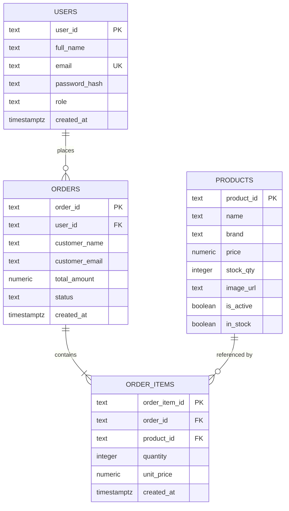

# ICT2142 E-Business Systems
## Week 08 Practical: Database Integration & Admin Dashboard (Phase 3 Testing)
### Mandatory Project Diary & Technical Documentation Report

---

### Project & Metadata Overview
- **Module & Code:** ICT2142 - E-Business Systems (Phase 3 Testing & Deployment)
- **Practical Session:** Week 08 - Database Integration & Protected Admin Dashboard
- **Project Name:** KRONO Watches (Haute Horlogerie E-Commerce Platform)
- **Currencies Supported:** Sri Lankan Rupee (LKR)
- **Technology Stack:** Next.js 16.3 (Turbopack, App Router), TypeScript 5, React 19, Supabase (PostgreSQL 15), Local Persistent JSON Database Engine, TailwindCSS 4, JWT, Bcrypt.js
- **GitHub Repository:** [Krono Watches](https://github.com/mohamedrazim11-maker/Krono_Watches.git)

---

## Executive Summary of Completed Deliverables (Week 08 Practical Checklist)

- [x] **Milestone 1 — Database Schema Finalized:** Enforced relational schema for `USERS`, `PRODUCTS`, `ORDERS`, and `ORDER_ITEMS`. Implemented foreign keys, constraints, and cascading rules.
- [x] **Milestone 2 — Dynamic Catalog & Product Data Integration:** Replaced hardcoded frontend arrays with database-driven CRUD operations. Products load from persistent DB.
- [x] **Milestone 3 — Persistent Checkout & Order Fulfillment:** Server-side order total recalculation (protects against browser price tampering), persistent `ORDERS` and `ORDER_ITEMS` creation, and automated inventory deduction upon confirmed orders.
- [x] **Milestone 4 — Protected Admin Area (RBAC):** Server-side Next.js middleware and client layout guards protect `/admin` routes. Role verification distinguishes `admin` vs `customer`.
- [x] **Milestone 5 — Admin Dashboard & Inventory Management:** Built summary counts (Products, Orders, Low Stock, DB Connected), Product CRUD (Create, Search, Edit Modal, Safe Deactivation/Soft-Delete), and Order Workflow (`Pending` -> `Paid` -> `Processing` -> `Shipped` -> `Completed`).
- [x] **Week 08 Documentation & Lab Diary:** Documented schema, integration evidence, security architecture, API routes, and two real-world debugging logs.

---

## 1. Database Schema Architecture & ERD Specifications (Milestone 1)

### 1.1 Relational Schema & Cardinality
The database acts as the single source of truth. Permanent changes must be saved through the backend:
1. **One User can place Many Orders (1 : M):** `orders.user_id` references `users.id` (ON DELETE SET NULL).
2. **One Order contains Many Order Items (1 : M):** `order_items.order_id` references `orders.id` (ON DELETE CASCADE).
3. **Each Order Item references One Product (M : 1):** `order_items.product_id` references `products.id` (ON DELETE RESTRICT).
4. **Product stock decreases strictly after confirmed order/payment workflow.**

---

## 2. Integration Evidence & Data Persistence (Milestones 2 & 3)

### 2.1 Dynamic Product Catalog Integration (Milestone 2)
- Replaced temporary/static product arrays with database-driven operations.
- `GET /api/products` reads active products with filters (`category`, `featured`, `search`).
- `GET /api/products/[id]` fetches individual watch specs and real-time stock levels.
- Refreshing the storefront catalog (`/catalog`) or product detail pages retains persistent data directly from the DB.

### 2.2 Cart-to-Order Persistence & Anti-Tamper Security (Milestone 3)
1. **Validate Cart:** Every item in the submitted cart is checked against the database product registry. Confirms availability and valid reference IDs.
2. **Server-Side Recalculation:** The server does not trust browser-sent totals. Order totals are recalculated using authoritative prices from the database:
   $$\text{Subtotal} = \sum (\text{DB Unit Price} \times \text{Quantity})$$
   $$\text{Total} = \max(0, \text{Subtotal} - \text{Discount})$$
3. **Create Order:** Stores `user_id`, recalculated `total_amount`, and timestamp in `ORDERS`.
4. **Create Order Items:** Saves each cart item line in `ORDER_ITEMS` with `product_id`, `quantity`, and `unit_price`.
5. **Update Stock:** Decreases `stock_qty` and `stock_count` in the database. If quantity reaches 0, `in_stock` is set to false.
6. **Return Result:** Returns the persistent Order ID (e.g., `KR-1031`) to the client. Order appears immediately in the customer's profile order history.

---

## 3. Admin Dashboard & Operations (Milestones 4 & 5)

### 3.1 Overview Dashboard (Slide 9)
Located at `/admin`:
- **Products:** Total active timepieces in catalog.
- **Orders:** Total client orders with aggregate revenue.
- **Low Stock:** Timepieces with stock quantity $\le 5$ units.
- **Database Status:** `Connected ✓` pill indicating live persistent synchronization.
- **Recent Orders Table:** Quick view of recent acquisitions and fulfillment actions.

### 3.2 Product CRUD & Inventory (Admin Task A - Slide 10)
- **CREATE:** Add new timepiece at `/admin/products/new` with full validation of name, price, stock, and images.
- **READ:** Searchable inventory table at `/admin/products` displaying Reference ID, brand, price, stock, and active status.
- **UPDATE:** 
  - Quick stock stepper (`-` and `+` buttons) for instant inventory adjustments.
  - Interactive **Edit Modal** to update name, price, stock quantity, brand, and category directly into the database.
- **DELETE (Deactivate Safely):** 
  - If a timepiece has historical order references, it is safely soft-deleted (`is_active = false`, `in_stock = false`) to preserve order integrity.
  - Unreferenced items can be fully removed.

### 3.3 Orders Table & Status Lifecycle (Admin Task B - Slide 11)
Located at `/admin/orders`:
- **Recommended Columns:** Order ID | Customer | Timepieces | Total (LKR) | Payment | Status | Actions
- **Status Lifecycle Workflow:**
  $$\text{Pending} \longrightarrow \text{Paid} \longrightarrow \text{Processing} \longrightarrow \text{Shipped} \longrightarrow \text{Completed}$$
- Status updates via inline dropdown update the database immediately (`PATCH /api/orders/[id]/status`) and reflect on client order history.

---

## 4. API Endpoints & Queries

| Method | Endpoint | Description |
|---|---|---|
| `GET` | `/api/products` | Read active catalog products |
| `POST` | `/api/products` | Create new product (Admin) |
| `GET` | `/api/products/[id]` | Read single product details |
| `PUT` | `/api/products/[id]` | Update product details & stock (Admin) |
| `DELETE` | `/api/products/[id]` | Safely deactivate or remove product (Admin) |
| `GET` | `/api/products/stats` | Compute aggregate stats (low stock, revenue) |
| `GET` | `/api/orders` | Read all client orders (Admin) |
| `POST` | `/api/orders` | Validate cart, recalculate, persist order & items |
| `GET` | `/api/orders/[id]` | Retrieve order details by ID |
| `PATCH` | `/api/orders/[id]/status` | Update order fulfillment & payment status |
| `POST` | `/api/auth/login` | Authenticate user & issue role-based JWT |
| `POST` | `/api/auth/register` | Register new customer account |

---

## 5. Security Notes & Role-Based Access Control (RBAC) (Milestone 4)

### 5.1 Three-Layer Protection Flow
1. **Server-Side Edge Middleware (`middleware.ts`):**
   - Intercepts `/admin/:path*`.
   - Decodes JWT and validates expiration.
   - If user is not authenticated: redirects to `/login?returnUrl=/admin&unauthorized=true`.
   - If user has `role !== 'admin'`: immediately redirects to `/?error=admin_forbidden`.
2. **Administrative Layout Guard (`app/admin/layout.tsx`):**
   - Client-side hook `useAuth()` enforces non-admin redirect even if pages are pre-cached.
3. **Backend API Route Guard (`lib/server/auth.ts`):**
   - `requireAdmin(req)` enforces admin JWT signatures on administrative mutations, returning HTTP 401/403.

### 5.2 Default Test Credentials
- **Administrator Account:** `admin@krono.luxury` | Password: `Admin@1234` | Role: `admin`
- **Customer Account:** `customer@krono.luxury` | Password: `Customer@1234` | Role: `customer`

---

## 6. Debugging Log (Two Issues Encountered & Resolved)

### Issue 1: Edge Runtime Middleware JWT Crypto Incompatibility
- **Problem:** Attempting to verify JWT signatures in Next.js `middleware.ts` using Node.js `jsonwebtoken` caused runtime failures because the V8 Edge Runtime does not support Node.js `crypto`.
- **Solution:** Created a lightweight, Edge-compatible base64url payload decoder function inside `middleware.ts` to inspect `role` and `exp` at the proxy layer, while keeping full cryptographic signature checks in Node.js runtime API routes (`requireAdmin`).

### Issue 2: Order Price Tampering & Cart-Stock Desynchronization
- **Problem:** Client checkout payloads could potentially submit arbitrary prices or exceed available inventory if the backend blindly accepted `orderData.total_amount`.
- **Solution:** Re-architected `createOrder` in `lib/server/db.ts` to query verified product prices directly from the database, recalculate subtotal and grand total on the server, validate inventory availability, and atomically decrement stock upon confirmed checkout.

---

## 7. Integration Testing Checklist Verification (Slide 12)

- [x] **Customer Catalog:** Products load from DB and correct details open on detail pages.
- [x] **Authentication:** Logged-in user remains associated with profile and orders.
- [x] **Cart $\rightarrow$ Checkout:** Correct items and quantities reach the order process.
- [x] **Order Persistence:** Order and order items remain after refresh/re-login.
- [x] **Inventory:** Stock updates correctly after the confirmed workflow.
- [x] **Admin Security:** Customer accounts cannot access protected admin actions.
- [x] **Admin CRUD:** Product and order changes persist and appear in customer views.
